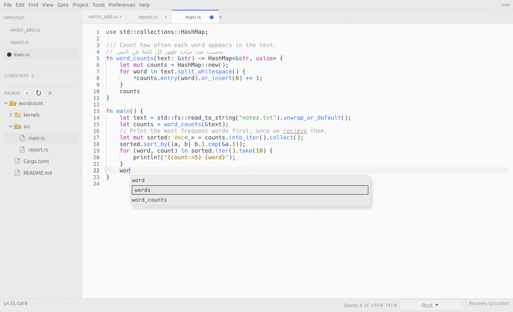

<p align="center">
  <picture>
    <source media="(prefers-color-scheme: dark)" srcset="assets/hedit-lockup-dark.svg">
    
  </picture>
</p>
<p align="center"><strong>Keep your train of thought.</strong></p>
<p align="center">
  <a href="https://github.com/MohamedElashri/hedit/releases">Download</a> ·
  <a href="#quick-start">Quick start</a> ·
  <a href="USER_GUIDE.md">User guide</a> ·
  <a href="DEVELOPER_GUIDE.md">Developer guide</a>
</p>

hedit is a native text editor for Linux, macOS, and Windows. It keeps open files
and unsaved notes between sessions, with project search, code editing, and
large-log viewing.

<p align="center">
  <picture>
    <source media="(prefers-color-scheme: dark)" srcset="docs/images/screenshot-dark.png">
    
  </picture>
</p>

- Recovery checkpoints, closed-file history, and undo/redo across sessions.
- Multiple cursors, split panes, completions, and go-to-definition.
- Markdown source, synchronized split preview, and reading modes, with math and Mermaid diagrams.
- Dark and light themes, plus an offline User Guide built into the app.
- Paged large files and read-only log following.
- Right-to-left Arabic and Hebrew, UTF-8/UTF-16, and legacy encodings.
- CUDA source editing everywhere; local CUDA tools on Linux.

## Install

**Linux and macOS:**

```sh
curl -fsSL https://raw.githubusercontent.com/MohamedElashri/hedit/main/install.sh | sh
```

The installer verifies checksums and installs under `~/.local` on Linux or
`~/Applications` on macOS. Add `~/.local/bin` to your `PATH` for the `hedit` command.

**Windows:** Download the x86-64 ZIP and its checksum from
[Releases](https://github.com/MohamedElashri/hedit/releases), verify it, extract it,
and run **hedit.exe**. Requires Windows 10 or newer and an OpenGL-capable driver.

CI builds and tests macOS and Windows packages; hands-on GUI validation is pending. See the
[installation guide](USER_GUIDE.md#installation) for platform requirements,
signing notes, manual downloads, and upgrades. In-app updates support Linux only.

## Quick start

```sh
hedit .
hedit application.log
hedit kernel.cu:42:8
printf 'keep this snippet\n' | hedit -
```

Use **Ctrl+P** to find files and **Ctrl+Shift+P** for commands (**Cmd** on macOS).
Open **Help → User guide** (**F1**) to read the bundled guide without internet.
Recovery checkpoints are periodic; save important work to disk.

See the [user guide](USER_GUIDE.md) for editing, shortcuts, recovery, and CUDA
tools; the [developer guide](DEVELOPER_GUIDE.md) for building and contributing;
and the [changelog](CHANGELOG.md) for release notes.

## Licence

[MIT](LICENSE).
