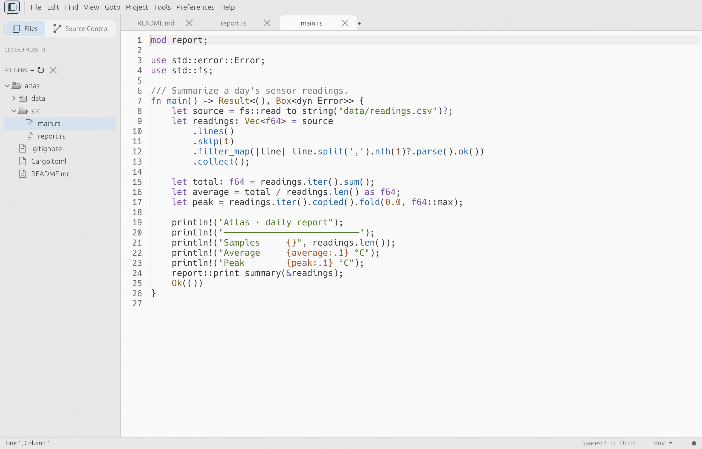
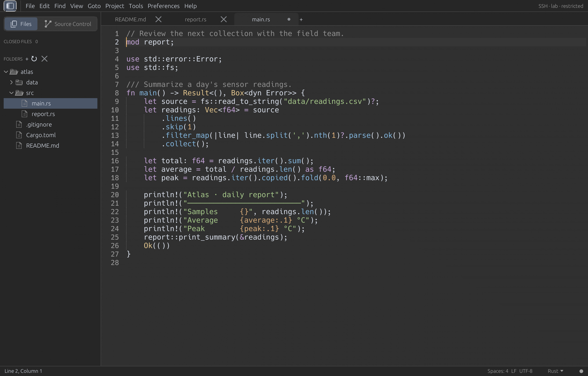
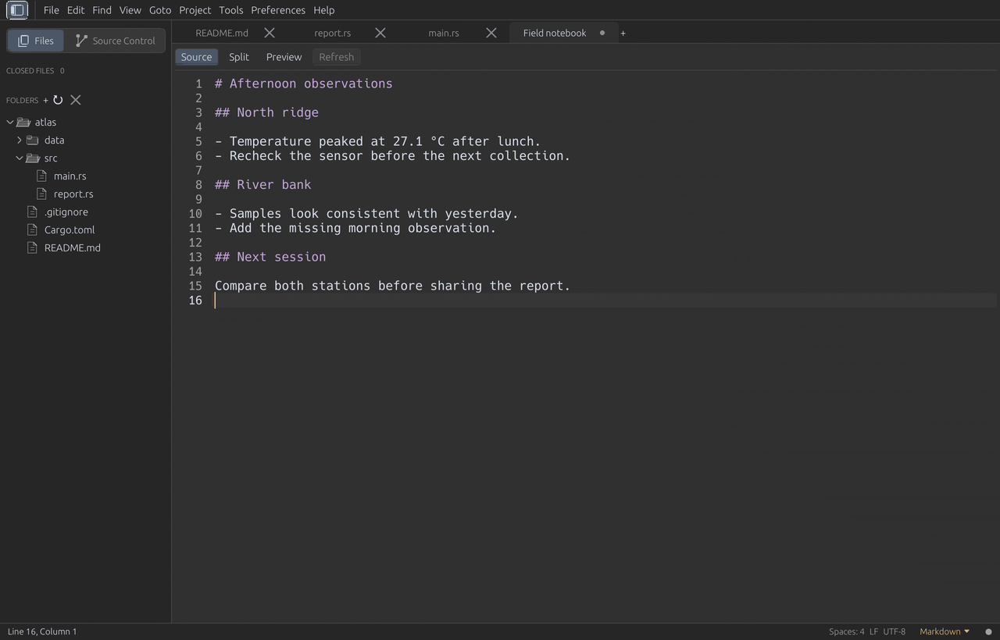
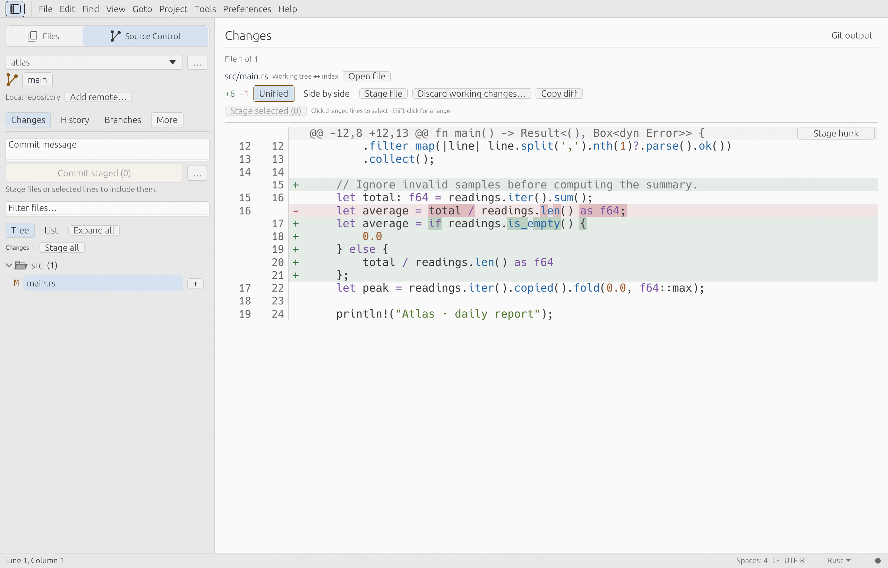
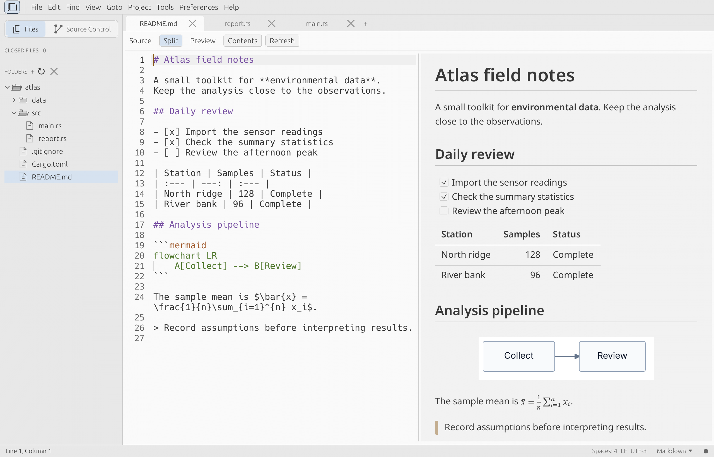
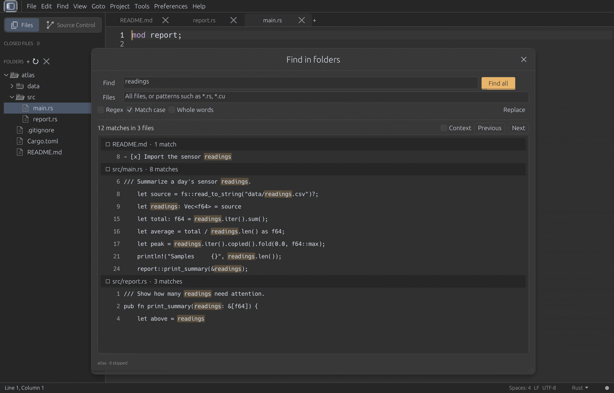
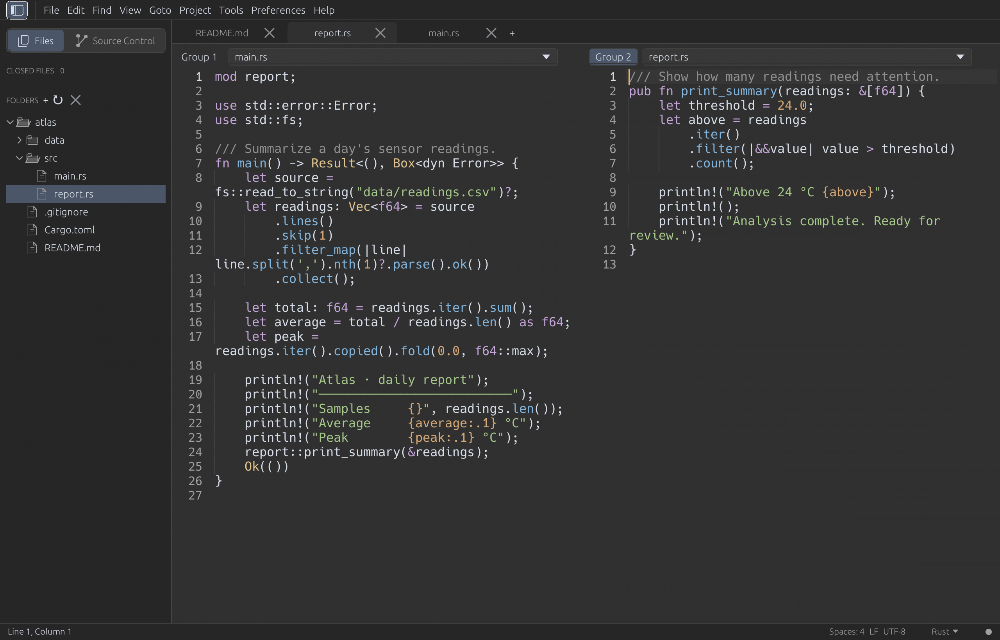
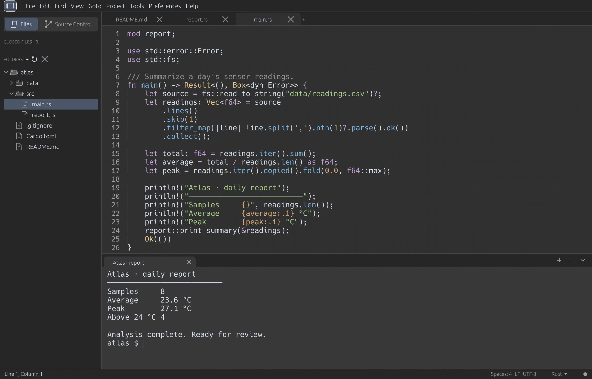
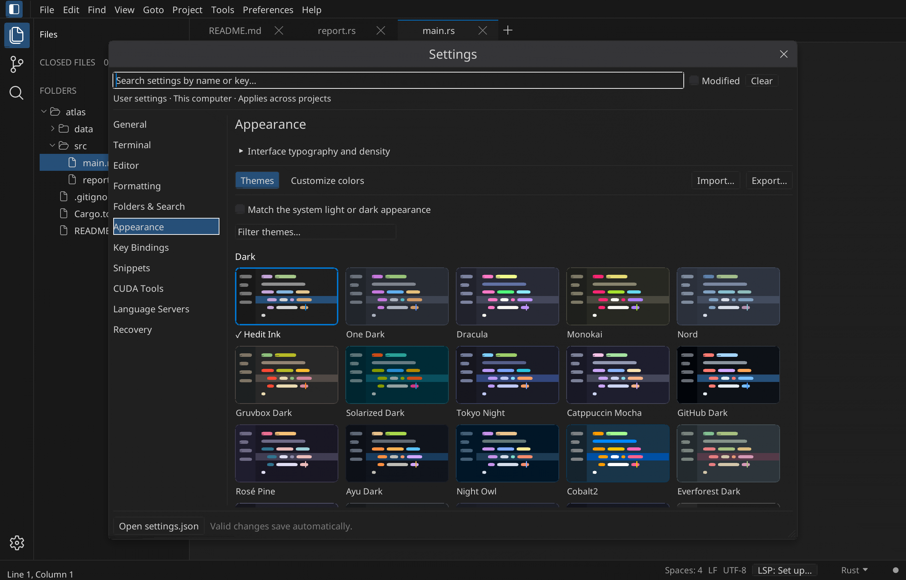

<p align="center">
  <picture>
    <source media="(prefers-color-scheme: dark)" srcset="assets/hedit-lockup-dark.svg">
    
  </picture>
</p>
<p align="center"><strong>A native editor that remembers your work.</strong></p>
<p align="center">Code, technical notes, large logs, and remote projects. Free and open source.</p>
<p align="center">
  <a href="https://github.com/MohamedElashri/hedit/releases/latest"></a>
</p>
<p align="center">
  <a href="https://github.com/MohamedElashri/hedit/actions/workflows/ci.yml?query=branch%3Amain"></a>
  <a href="LICENSE"></a>
</p>
<p align="center">
  <a href="#install">Install</a> ·
  <a href="#quick-start">Quick start</a> ·
  <a href="https://melashri.net/hedit/">Documentation</a> ·
  <a href="https://melashri.net/hedit/plugins/">Plugin development</a> ·
  <a href="CHANGELOG.md">Release notes</a>
</p>

<p align="center">
  <picture>
    <source media="(prefers-color-scheme: dark)" srcset="docs/images/screenshot-dark.png">
    
  </picture>
</p>

hedit is a native text editor for developers and researchers moving between code,
technical notes, logs, and SSH servers. Open files and unsaved notes return when
you reopen the app. Experimental SSH workspaces keep recovery on the remote host.

## Install

Choose your platform's archive from the release's **Assets**, together with its
matching `.sha256` checksum. No compiler is needed for a stable download.

| Platform | Stable download | Requirements |
| --- | --- | --- |
| Linux | [DEB, RPM, AppImage, or tarball](https://github.com/MohamedElashri/hedit/releases/latest) | x86-64 or ARM64; X11/Wayland and OpenGL |
| macOS | [Universal app ZIP](https://github.com/MohamedElashri/hedit/releases/latest) | macOS 11+; Apple Silicon or Intel |
| Windows | [Portable x86-64 ZIP](https://github.com/MohamedElashri/hedit/releases/latest) | Windows 10+; OpenGL-capable driver |

For DEB/RPM/AppImage instructions, see [Linux packages](USER_GUIDE.md#linux-packages).

On Linux and macOS, you can also let the installer choose and verify the package:

```sh
curl -fsSL https://raw.githubusercontent.com/MohamedElashri/hedit/main/install.sh | sh
```

It installs under `~/.local` on Linux or `~/Applications` on macOS. Add
`~/.local/bin` to `PATH` for the command. On Windows, verify and extract the ZIP,
then run **hedit.exe**. macOS builds are not notarized; Windows builds are unsigned.
See [installation and verification](USER_GUIDE.md#installation) for details.

## Quick start

Open a project, jump to a source location, or keep a note from the terminal:

```sh
hedit .
hedit src/main.rs:12:5
printf 'keep this note\n' | hedit -
```

**Ctrl+P** finds files; **Ctrl+Shift+P** runs commands (**Cmd** on macOS).
**F1** opens the offline guide. Enable **Settings → Terminal** for an integrated shell.

## Features

Check the [release notes](CHANGELOG.md) for feature availability in stable downloads.
Improvements awaiting a release can be tried by [building from source](DEVELOPER_GUIDE.md).

- **Resume unfinished work.** Restore tabs, unsaved notes, and undo history;
  recover closed notes from Closed Files. Checkpoints run every few seconds,
  so save important work. [Recovery details](USER_GUIDE.md#recovery).
- **Move between local and remote projects.** Click SSH-config hosts or saved
  workspaces in Remote Explorer to connect, with automatic user-local helper
  installation, connection status, and automatic reconnect. Edit and search over SSH, review Git,
  and run builds or shells with explicit execution trust. Remote document content
  stays out of Hedit's local recovery. SSH is experimental; matching helpers are installed automatically for non-root
  accounts. [Setup, privacy, and limits](USER_GUIDE.md#ssh-remote-workspaces).
- **Arrange your workspace.** Keep independent editor groups beside persistent
  Explorer, Search and Source Control sidebars. Use one resizable panel for
  Problems, Output and Terminal, file breadcrumbs and an optional Outline.
  [Layout controls](USER_GUIDE.md#views-and-layout).
- **Keep code and technical notes together.** Stage Git changes by file, hunk, or
  line. Write Markdown beside a synchronized preview with local images, LaTeX
  equations, and Mermaid diagrams. [Git](USER_GUIDE.md#source-control) ·
  [Markdown](USER_GUIDE.md#markdown-preview).
- **Extend local editing.** Add editing commands, language providers, syntax/theme
  packs and scoped project integrations. Review document, folder, endpoint and
  native-tool permissions; inspect proposed edits before applying them.
  Author and test signed bundles with the built-in CLI.
  [Extensions](USER_GUIDE.md#extensions) · [Authoring reference](docs/extensions.md).

Multiple cursors, snippets, word completion, folding, split panes, background
project search, and paged log viewing support everyday editing. Customize themes,
fonts, and keys; edit Arabic/Hebrew and legacy encodings. CUDA highlighting works
everywhere, with local CUDA tools on Linux.
Search Settings by name or key, filter modified values, and reset individual preferences.
Choose UI fonts and density independently of editor and terminal typography.
[Settings preview](docs/images/settings.png).

Language servers can be installed, configured, restarted, and removed in
**Settings → Language Servers**. Managed Rust, C/C++, Python, Lua and TOML servers
and external-server presets provide completion, diagnostics, navigation, hover information, and
formatting for local or trusted SSH workspaces. Review symbol renames and quick
fixes before applying undoable edits across files.
[Setup and supported features](USER_GUIDE.md#language-servers). Terminal fonts and
colors can optionally be customized separately from the app.

## Looks

Real Hedit views from a small sample project. Open a screenshot for the full-size view.

**Edit remotely, with recovery on the host.** This view uses a disposable OpenSSH
server, with execution restricted and an edited file awaiting a separate Save.

[](docs/images/ssh.png)

**Pick up an unfinished note.** Type a note without saving a file, close its tab,
reopen the session, and recover it from Closed Files. This demo uses a completed
recovery checkpoint. [Recovery behavior](USER_GUIDE.md#recovery).

[](docs/images/recovery.png)

| Review only the changes you want | Keep notes beside their rendered document |
| :---: | :---: |
| [](docs/images/git.png) | [](docs/images/markdown.png) |
| [File, hunk, and line staging](USER_GUIDE.md#source-control) | [Synchronized Markdown preview](USER_GUIDE.md#markdown-preview) |

| Find a change across the project | Keep related files in view |
| :---: | :---: |
| [](docs/images/search.png) | [](docs/images/split-panes.png) |
| [Project search and replacement](USER_GUIDE.md#finding-and-navigating) | [Independent editor panes](USER_GUIDE.md#views-and-layout) |

| Run a shell without leaving your project | Choose colors that suit your work |
| :---: | :---: |
| [](docs/images/terminal.png) | [](docs/images/themes.png) |
| [Opt-in terminal](USER_GUIDE.md#integrated-terminal) | [Built-in and custom themes](USER_GUIDE.md#appearance) |

[Documentation](https://melashri.net/hedit/) · [Offline user guide](USER_GUIDE.md) ·
[Plugin development](https://melashri.net/hedit/plugins/) · [Build and contribute](DEVELOPER_GUIDE.md) ·
[Report an issue](https://github.com/MohamedElashri/hedit/issues)

## Licence

Free and open source under the [MIT licence](LICENSE).
