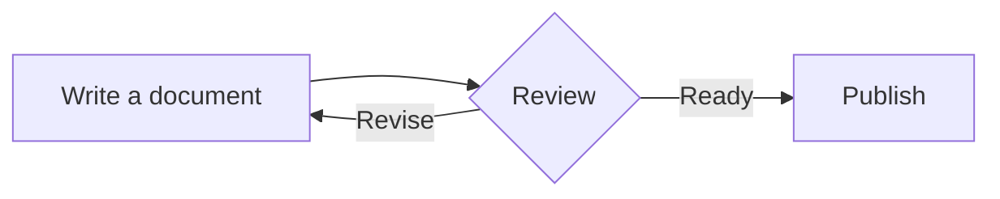
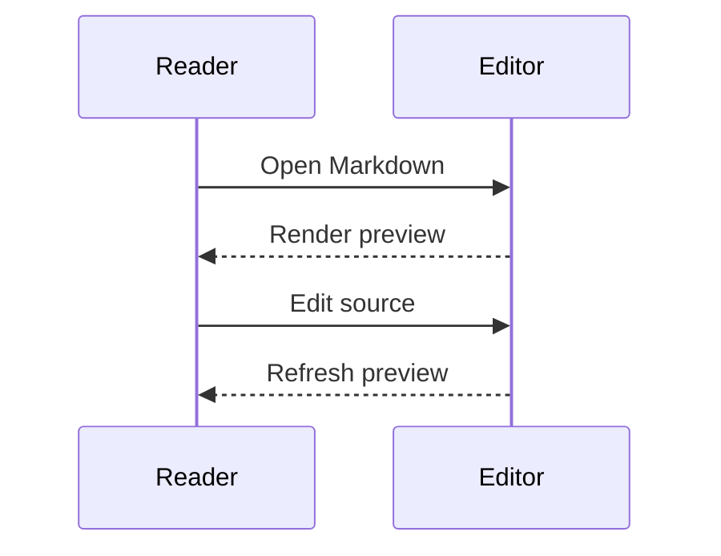
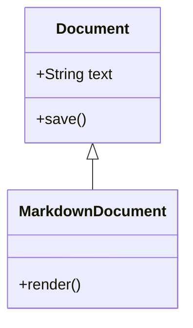

# Native diagrams

## Flowchart



Text after the flowchart.

## Sequence



Text after the sequence diagram.

## Class diagram



Text after the class diagram.

## Invalid diagram

```mermaid
not a valid diagram at all
```

Invalid notation must remain readable, with an error available on hover.

[Top](#) · [Reading](typography.md)
