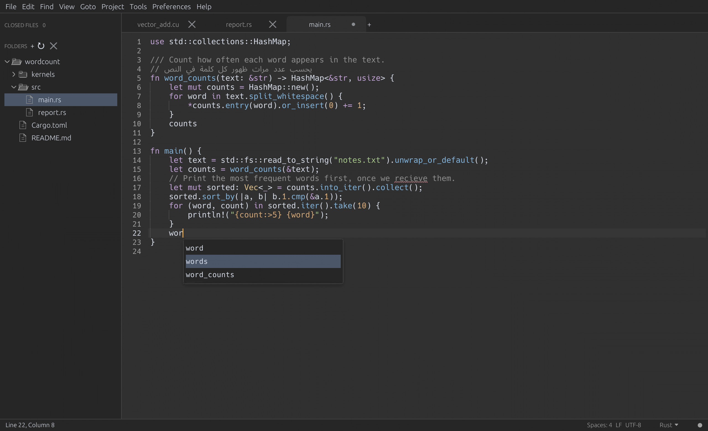
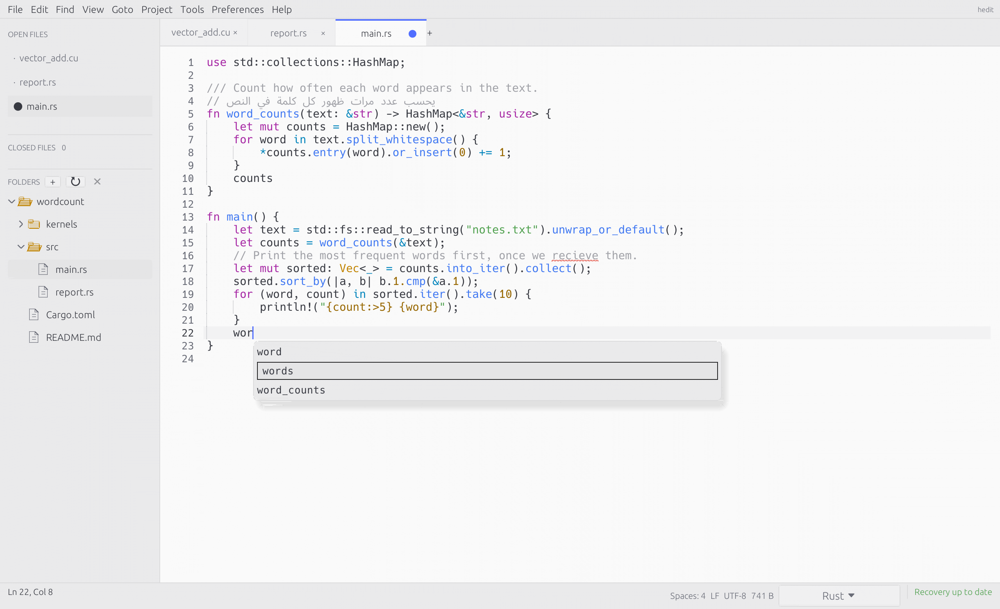

# Images and fallback

## Local image

Text above the local image.

Text below the local image.

## Missing image

Text after the missing image.

## Blocked remote image

Text after the blocked image.

## Image link

Text after the linked image.

[Top](#) · [Reading](typography.md)
